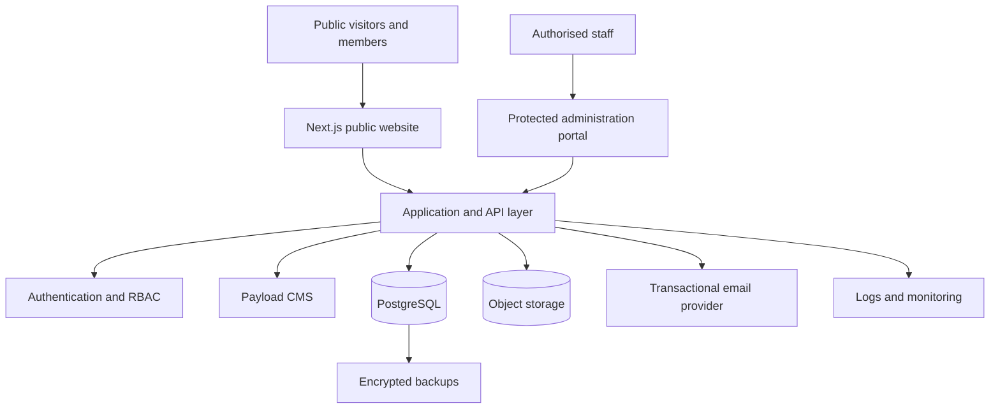

# UBA Technical Architecture

## 1. System boundary

UBA is an independent institutional website and administrative platform. It is not a replacement for, subdomain, or administrative extension of Pakistan Business Forum.

**Separate assets required:** domain, DNS zone, source repository, hosting project, database, object-storage bucket, application secrets, analytics property, email sending domain and backup policy.

No PBF production systems or data stores are to be modified.

## 2. Logical architecture



## 3. Recommended stack

| Layer | Selection | Notes |
|---|---|---|
| Application | Next.js App Router + TypeScript | Public pages and protected admin |
| Styling | Tailwind CSS | Responsive design tokens |
| Components | shadcn/ui | Accessible primitives; customise visual language |
| CMS | Payload CMS | Editorial content and selected workflows |
| Database | PostgreSQL | Relational institutional records |
| Authentication | Secure server-side sessions | MFA for privileged accounts |
| Media | S3-compatible object storage | Private documents and public media separated |
| CDN and DNS | Cloudflare | DNS, CDN, WAF/rate limiting as appropriate |
| Hosting | Vercel or equivalent | Select after deployment constraints review |
| Email | Transactional email provider | Domain-authenticated transactional delivery |

Pin supported versions when implementation begins. Verify current compatibility at that time; do not assume package versions.

## 4. Modular monolith boundaries

Keep one deployable application with clear internal modules:

- Identity and access
- Public content and CMS
- Leadership and appointments
- Membership and verification
- Chapters and sectors
- Committees and governance records
- Policy publications
- News, press releases and media
- FPCCI election information and campaign content
- Contact and enquiries
- Audit and operational administration

Use module-level service boundaries and typed interfaces. Do not create microservices, message brokers or distributed transactions at this stage.

## 5. Public route map

- `/` — Home
- `/about` — About UBA
- `/leadership` — Approved leadership directory
- `/chapters` — National and regional chapters
- `/policy` — Policy and advocacy
- `/fpcci-elections` — UBA electoral information and updates
- `/membership` — Membership information and application
- `/news` — News and press releases
- `/documents` — Publicly approved documents
- `/contact` — Contact
- `/privacy` — Privacy notice
- `/admin` — Protected administrative application

## 6. Administration boundaries

Content publication, office-bearer appointment, membership approval, financial administration and technical administration are different powers. A CMS administrator must not automatically acquire institutional approval authority.

Use workflow states and immutable audit events for significant actions. The constitution and approved delegations govern who may approve each action.

## 7. Integrations

Initial integrations should be limited to:

- Transactional email
- Analytics with privacy-conscious configuration
- Object storage
- Backups and monitoring

Payment collection, CRM integration and messaging integrations are deferred until business requirements, provider selection and compliance review are complete.

## 8. Hosting topology

```text
uba-domain
  └── Cloudflare DNS / CDN / WAF
        └── UBA application hosting
              ├── Next.js public site
              ├── Protected admin
              └── Server-side API
                    ├── Dedicated PostgreSQL
                    ├── Dedicated object storage
                    └── Transactional email
```

Production, preview/staging and local development environments must use separate credentials and databases.

## 9. Non-functional targets

Set and measure before launch:

- Responsive support from small mobile screens upward
- WCAG 2.2 AA as the accessibility target
- Strong Core Web Vitals on representative pages
- Server-side validation for all writes
- Least-privilege access
- Documented recovery procedures
- No secrets in source control
- Automated checks for lint, type safety and tests
- Reproducible build and deployment

Performance objectives should be measured on real builds rather than claimed in advance.
