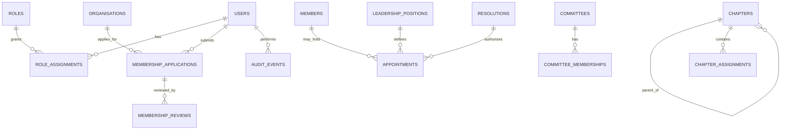

# UBA Database Model

PostgreSQL is the system of record. Use UUID primary keys, UTC timestamps, foreign keys, explicit status enums, indexes for real query patterns and migrations committed to source control.

## Core entities

| Table | Purpose | Important relationships |
|---|---|---|
| users | Authenticated users and staff | Links to role assignments |
| roles | Named application roles | Links to permissions |
| permissions | Granular capabilities | Assigned through role_permissions |
| role_assignments | User role grants and scope | User, role, optional chapter scope |
| members | Approved membership records | May link to users and organisations |
| organisations | Businesses, chambers and associations | Linked to member applications |
| membership_applications | Application submissions and review state | Applicant, organisation, reviewers |
| membership_reviews | Review decisions and comments | Application and reviewer |
| leadership_positions | Approved position definitions | Used by appointment records |
| leadership_profiles | Public profiles | Person and optional user |
| appointments | Time-bound appointments | Profile, position, approving resolution |
| chapters | Geographic/sectoral units | Parent chapter for hierarchy |
| chapter_assignments | People assigned to chapters | User/profile and chapter |
| sectors | Sector taxonomy | Used by members and chapters |
| committees | Standing or ad hoc committees | Optional parent committee |
| committee_memberships | Committee membership terms | Committee and profile |
| resolutions | Governance decisions | Meeting and approval record |
| resolution_signatories | Recorded signatories | Resolution and profile |
| publications | Policy papers and documents | Author, status, approved file |
| press_releases | Official public statements | Author and approval state |
| election_cycles | FPCCI electoral cycle records | Campaign content and event records |
| candidates | Candidate profiles and disclosures | Election cycle |
| events | Meetings and public events | Optional chapter and election cycle |
| media_assets | Public and private asset metadata | Owner and access classification |
| contact_enquiries | Contact form submissions | Optional assignment |
| audit_events | Append-only activity records | Actor and target entity |

## Modelling rules

1. Do not store all institutional concepts in a single generic JSON document.
2. Preserve appointment history with effective_from, effective_to, approval_resolution_id and status.
3. Never overwrite an approved resolution. Corrections should be new, linked records with an audit event.
4. Membership status changes must retain reviewer, timestamp, reason and supporting documents metadata.
5. Store uploaded files outside the relational database; store checksums, ownership, classification and storage keys in metadata.
6. Do not store passwords directly. Use the authentication provider's supported password hashing/session implementation.
7. Financial records, if introduced, require separate permissions and a traceable ledger-like design; do not treat a payment flag as accounting.
8. Avoid collecting CNIC or sensitive identity information unless a documented legal/business requirement exists.

## Suggested initial enums

- application_status: submitted, under_review, information_requested, approved, rejected, withdrawn
- publication_status: draft, in_review, approved, scheduled, published, archived
- appointment_status: proposed, approved, active, expired, revoked
- resolution_status: draft, adopted, superseded, rescinded
- asset_visibility: public, internal, restricted

## Initial relationship outline

The implementation team must validate this model against the approved constitution and membership rules before creating production migrations.
